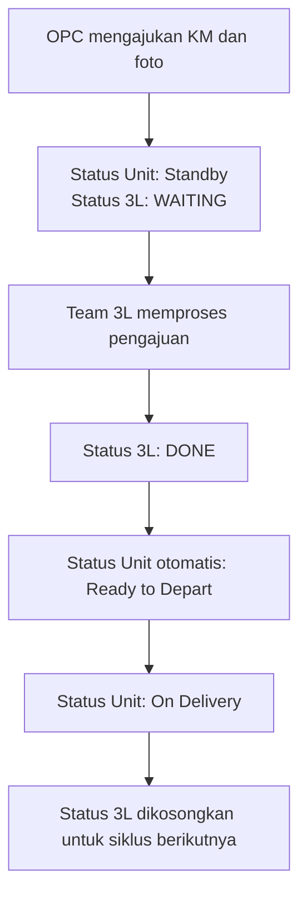

# Artefak Script Untuk Kawan Kawan nya KINK BAGINDA FIQRI SETIAWAN CDE CHILLER

# Monitoring Kalibrasi KM

Web App internal berbasis Google Apps Script dan Google Sheets untuk mengelola pengajuan, pemantauan, analitik, serta administrasi proses kalibrasi kilometer armada. Aplikasi menyediakan autentikasi mandiri, pembatasan akses berbasis peran dan Operating Point, histori perubahan yang dapat diaudit, serta alat pemeliharaan database.

## Fitur Utama

### Monitoring dan pengajuan kalibrasi

- Menampilkan unit berdasarkan cakupan Operating Point pengguna.
- Mencatat pengajuan kalibrasi, KM odometer, tanggal, catatan, dan foto odometer.
- Mengelola Status Unit dan Status 3L, termasuk pembaruan massal Status 3L.
- Menyimpan histori kalibrasi, Status Unit, dan Status 3L secara terpisah.
- Menyediakan ringkasan unit dan detail riwayat setiap siklus kalibrasi.
- Menyinkronkan perubahan Status 3L yang dilakukan langsung pada Google Sheet.

### Analitik

- Ringkasan volume dan tren kalibrasi berdasarkan periode.
- Analisis Operating Point dan TOH/WOH.
- Pemantauan SLA, aging, beban kerja tim, dan pengajuan berulang.
- Pemeriksaan kualitas serta kelengkapan data.
- Ledger analitik terkelola dengan satu baris untuk setiap siklus kalibrasi.

### Administrasi

- Pengelolaan pengguna, role, permission, dan cakupan Operating Point.
- Pengelolaan master unit: tambah, ubah, pindah OP, nonaktifkan, dan aktifkan kembali.
- Workflow permintaan dan persetujuan perubahan master unit yang dapat diaktifkan melalui konfigurasi.
- Pengelolaan area coverage, opsi Status 3L, dan parameter aplikasi.
- Import CSV dengan tahap preview dan export data operasional tanpa mengekspos password hash atau salt.
- Audit trail, pemantauan sesi aktif, pemeriksaan kesehatan database, backup, dan recovery.

### Keamanan

- Autentikasi username/email dan password pada sisi server.
- Password disimpan sebagai hash bersalt dan menggunakan pepper pada Script Properties.
- Session berlaku maksimal 8 jam, idle timeout 30 menit, dan sesi dapat dicabut oleh administrator.
- Akun dikunci selama 15 menit setelah 5 kali kegagalan login.
- Verifikasi permission dilakukan kembali pada setiap endpoint server.
- Pembatasan akses data berdasarkan Operating Point yang diberikan kepada pengguna.

## Alur Utama Kalibrasi

Perubahan penting dicatat pada sheet histori dan activity log agar jejak pengguna, waktu, sumber, nilai lama, serta nilai baru dapat ditelusuri.

## Teknologi

| Komponen | Kegunaan |
|---|---|
| Google Apps Script (V8) | Backend, autentikasi, workflow, trigger, dan API untuk antarmuka |
| Google Sheets | Database operasional dan konfigurasi |
| Google Drive API v3 | Penyimpanan foto serta backup/recovery Spreadsheet |
| HTML, CSS, JavaScript | Antarmuka Web App |
| Bootstrap 5.3.8 | Layout dan komponen UI |
| Tom Select 2.6.2 | Input pilihan yang dapat dicari |
| SheetJS 0.20.3 | Pemrosesan data tabular pada browser |

## Struktur Repository

| File | Fungsi |
|---|---|
| `Code.gs` | Entry point Web App, autentikasi, RBAC, setup database, workflow unit, histori, serta trigger |
| `Analytics.gs` | Agregasi dan endpoint analitik kalibrasi |
| `Administration.gs` | Administration Center, master unit, import/export, audit, health check, backup, dan recovery |
| `index.html` | Struktur halaman dan logika antarmuka pengguna |
| `Styles.html` | Seluruh style aplikasi yang dimuat sebagai partial HTML |
| `appsscript.json` | Manifest Apps Script, scope OAuth, runtime, zona waktu, dan konfigurasi Web App |

## Role dan Hak Akses Bawaan

| Role | Akses utama |
|---|---|
| `SUPER_ADMIN` | Seluruh fitur, pengelolaan user/role, setup, maintenance, audit, backup, dan recovery |
| `ADMIN_BITRANS` | Monitoring, update unit dan Status 3L, master unit, approval, serta audit |
| `OH` | Monitoring, melihat pengajuan, dan mengajukan perubahan master unit |
| `IT` | Monitoring dan akses baca pengajuan |
| `TEAM_3L` | Monitoring dan pembaruan Status 3L |
| `OPC` | Monitoring, pengajuan/update unit, dan permintaan perubahan master unit sesuai cakupan OP |
| `VIEWER` | Akses baca monitoring dan pengajuan |

Permission yang tersedia adalah `ACCESS_APP`, `VIEW_MONITORING`, `VIEW_MASTER_UNIT`, `UPDATE_UNIT`, `UPDATE_STATUS_3L`, `MANAGE_MASTER_UNIT`, `REQUEST_MASTER_UNIT_CHANGE`, `APPROVE_MASTER_UNIT_CHANGE`, `MANAGE_USERS`, `ADMIN_SETUP`, dan `VIEW_AUDIT`.

> Role dan permission tersimpan di sheet `KM_ROLES`. Perubahan konfigurasi role dilakukan melalui Administration Center dan tetap divalidasi oleh backend.

## Struktur Database Google Sheets

Setup aplikasi membuat atau menormalkan sheet berikut.

| Sheet | Isi |
|---|---|
| `MASTER_CONFIG` | Direktori OP–OPC–TOH/WOH, opsi Status 3L, dan parameter aplikasi |
| `MASTER_UNIT` | Data utama armada, odometer, status, foto, identitas unit, serta metadata audit |
| `HISTORY_KALIBRASI_KM` | Event dan snapshot setiap siklus kalibrasi |
| `ANALYTICS_KALIBRASI_KM` | Proyeksi bersih satu baris per siklus untuk analitik |
| `STATUS_UNIT_HISTORY` | Histori perubahan Status Unit |
| `STATUS_3L_HISTORY` | Histori perubahan Status 3L beserta dampaknya pada Status Unit |
| `MASTER_UNIT_MOVEMENT_HISTORY` | Histori perubahan identitas, tipe, dan perpindahan OP unit |
| `MASTER_UNIT_CHANGE_REQUESTS` | Permintaan dan approval perubahan master unit |
| `KM_USERS` | Akun, role, cakupan OP, status akun, dan credential terenkripsi |
| `KM_ROLES` | Definisi role dan permission |
| `KM_SESSIONS` | Sesi login aktif, kedaluwarsa, dan pencabutan sesi |
| `KM_AUTH_LOG` | Audit aktivitas autentikasi |
| `KM_ACTIVITY_LOG` | Audit aktivitas aplikasi dan perubahan data |

Sheet histori dan audit dikelola sebagai catatan operasional. Hindari mengubah atau menghapus isinya secara manual.

## Instalasi

### 1. Siapkan Spreadsheet

1. Buat Google Spreadsheet baru menggunakan akun yang akan menjadi owner aplikasi.
2. Buka **Extensions → Apps Script**.
3. Pastikan project terikat pada Spreadsheet tersebut.

### 2. Tambahkan source code

Buat file di Apps Script dengan nama yang sama seperti repository, lalu salin isi masing-masing file:

- `Code.gs`
- `Analytics.gs`
- `Administration.gs`
- `index.html`
- `Styles.html`
- `appsscript.json`

Untuk mengedit manifest, aktifkan **Project Settings → Show `appsscript.json` manifest file in editor**.

### 3. Aktifkan layanan dan izin

Manifest sudah mendefinisikan:

- zona waktu `Asia/Jakarta`;
- runtime V8;
- Google Drive advanced service versi 3;
- scope Spreadsheet, Drive, email, ScriptApp, dan email pengguna.

Jika editor meminta konfigurasi layanan Google Cloud, aktifkan **Google Drive API** pada project Cloud yang terkait. Jalankan fungsi setup menggunakan akun owner dan setujui seluruh izin yang diminta.

### 4. Inisialisasi aplikasi

1. Dari Apps Script editor, pilih dan jalankan `setupAplikasiKalibrasiKM_` sebagai owner Spreadsheet.
2. Simpan hasil eksekusi yang berisi username dan temporary password `SUPER_ADMIN`. Password sementara hanya ditampilkan pada hasil eksekusi tersebut.
3. Setup membuat struktur database, konfigurasi RBAC, akun owner, ledger analitik, serta trigger yang diperlukan.
4. Login pertama menggunakan email/username owner dan temporary password.
5. Segera ganti password ketika aplikasi meminta perubahan password.

Jika autentikasi sudah pernah diinisialisasi, setup mempertahankan credential owner yang aktif dan tidak mengganti password.

### 5. Deploy sebagai Web App

1. Klik **Deploy → New deployment**.
2. Pilih tipe **Web app**.
3. Atur **Execute as** menjadi akun yang melakukan deployment.
4. Atur akses sesuai manifest, yaitu **Anyone**.
5. Klik **Deploy**, selesaikan otorisasi, lalu simpan URL Web App.

Walaupun halaman deployment dapat diakses publik, data dan tindakan aplikasi tetap berada di balik login, session server-side, RBAC, serta scope Operating Point. Jangan membagikan Spreadsheet database atau credential administrator kepada pengguna yang tidak berwenang.

## Konfigurasi Awal

Setelah login sebagai `SUPER_ADMIN`, buka **Administration** dan lakukan konfigurasi berikut:

1. Isi area coverage pada `MASTER_CONFIG`: Operating Point, nama OPC/WHC, dan nama TOH/WOH.
2. Periksa daftar opsi Status 3L.
3. Tambahkan master unit atau lakukan import data setelah preview berhasil.
4. Buat pengguna, pilih satu atau beberapa role, lalu tentukan cakupan Operating Point.
5. Distribusikan temporary password melalui kanal yang aman dan minta pengguna menggantinya saat login pertama.
6. Periksa Database Health dan pastikan trigger serta seluruh sheet berstatus siap.
7. Buat backup awal sebelum aplikasi digunakan secara operasional.

Parameter penting di `MASTER_CONFIG`:

| Parameter | Keterangan |
|---|---|
| `APP_NAME` | Nama aplikasi yang ditampilkan |
| `PAGE_SIZE` | Jumlah data per halaman; nilai yang didukung: 15, 30, atau 50 |
| `MASTER_UNIT_APPROVAL_ENABLED` | Mengaktifkan workflow approval perubahan master unit (`TRUE`/`FALSE`) |
| `SCHEMA_VERSION` | Versi struktur database yang dikelola aplikasi |

## Trigger Otomatis

| Handler | Tipe | Fungsi |
|---|---|---|
| `handleKalibrasiKmSheetEdit` | Installable `onEdit` | Memproses perubahan yang dilakukan langsung pada Spreadsheet |
| `syncExternalStatus3LChanges` | Time-driven, setiap 1 menit | Mendeteksi dan merekonsiliasi perubahan Status 3L eksternal |

Watcher memberikan grace period sekitar 2 menit untuk edit manual. Database Health dapat digunakan untuk memeriksa kesiapan dan duplikasi trigger.

## Import, Export, Backup, dan Recovery

- Import CSV konfigurasi dibatasi maksimal 1.500 baris / 2 MB; Bulk Management master unit dibatasi maksimal 1.000 baris. Keduanya divalidasi sebelum data diterapkan.
- Export tersedia untuk master unit, movement history, change requests, area coverage, workflow, pengguna, role, audit trail, dan sesi aktif.
- Export pengguna tidak menyertakan password hash maupun salt.
- Backup disimpan sebagai salinan Spreadsheet di folder Google Drive `Kalibrasi KM Backups`.
- Recovery hanya dapat dijalankan administrator, membutuhkan konfirmasi teks `RESTORE`, dan otomatis membuat backup `PRE_RESTORE` terlebih dahulu.

Selalu buat backup sebelum migrasi, import besar, perbaikan struktur, atau recovery.

## Operasional dan Maintenance

Menu **Kalibrasi KM** pada Spreadsheet hanya tampil bagi pengguna yang memiliki permission `ADMIN_SETUP`. Menu tersebut menyediakan:

- setup/migrasi database;
- audit database dan relasi foto tanpa mengubah data;
- audit drift serta sinkronisasi Status 3L eksternal;
- repair workflow Status 3L;
- rebuild ledger analitik;
- perapihan struktur disertai backup.

Gunakan fungsi repair hanya setelah membaca hasil audit dan membuat backup. Proses maintenance owner menggunakan lock untuk mencegah perubahan bersamaan.

## Pemecahan Masalah

| Masalah | Pemeriksaan |
|---|---|
| Login gagal setelah instalasi | Pastikan setup dijalankan oleh owner, akun aktif, temporary password disalin dengan benar, dan pepper tersedia di Script Properties |
| Menu `Kalibrasi KM` tidak muncul | Muat ulang Spreadsheet dan pastikan akun memiliki role aktif dengan permission `ADMIN_SETUP` |
| Data pengguna tidak terlihat | Periksa cakupan Operating Point pada `KM_USERS` dan relasi OP pada `MASTER_CONFIG` |
| Update Status 3L tidak tersinkron | Periksa trigger `syncExternalStatus3LChanges`, hasil Database Health, dan format status yang diizinkan |
| Foto tidak dapat disimpan/dibuka | Pastikan izin Google Drive telah disetujui dan relasi foto lolos audit |
| Analitik berbeda dari histori | Jalankan audit ledger; lakukan rebuild analytics ledger setelah backup bila audit menyatakan tidak siap |
| Perubahan struktur gagal | Pastikan fungsi dijalankan langsung oleh owner Spreadsheet dan tidak ada proses lain yang sedang memegang lock |

## Checklist Sebelum Go-Live

- [ ] Setup aplikasi selesai tanpa error.
- [ ] Temporary password owner sudah diganti.
- [ ] Area coverage dan opsi Status 3L sudah benar.
- [ ] Master unit sudah divalidasi.
- [ ] Pengguna, role, dan scope OP sudah diuji.
- [ ] Trigger edit dan watcher Status 3L aktif tepat satu kali.
- [ ] Pengajuan, upload foto, perubahan Status 3L, dan perpindahan Status Unit sudah diuji end-to-end.
- [ ] Analytics ledger dan Database Health berstatus siap.
- [ ] Backup awal sudah tersedia.
- [ ] URL deployment hanya dibagikan kepada pengguna yang berwenang.

## Catatan Source Code

Source aplikasi pada repository ini dipertahankan sesuai file yang disediakan. Dokumentasi ini menjelaskan perilaku yang telah tersedia tanpa mengubah logika aplikasi.

